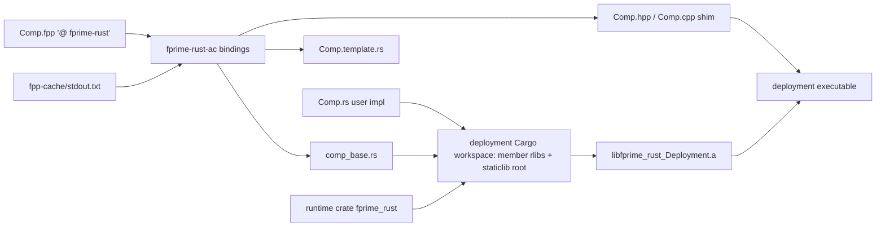
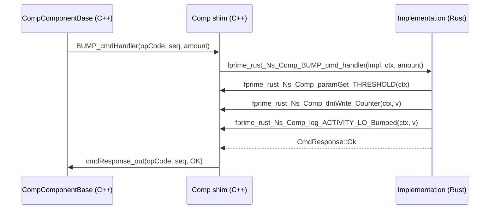

# fprime-rust — Software Design Description

## Introduction

`fprime-rust` lets an F Prime component be implemented in Rust. The component stays an FPP model; a
single annotation marks it as Rust-implemented; the `fprime-rust-ac` autocoder emits the C++ shim that
plugs into the standard autocoded component base, a generated Rust base module (the typed handler
trait and the `Context` helpers), and a user template. One deployment-level Cargo workspace compiles
every Rust component of a deployment and the runtime into one static archive linked once into the
executable. The user writes the `.fpp` and the `.rs`; no `.cpp`/`.hpp` is written by hand.

## Requirements

| ID | Requirement | Verification |
|---|---|---|
| REQ-FprimeRust-001 | A component annotated `@ fprime-rust` in FPP shall be generated with a Rust implementation surface. | Unit Test |
| REQ-FprimeRust-002 | The autocoder shall load the FPP model by in-process analysis of the module's translation units and their closure. | Unit Test |
| REQ-FprimeRust-003 | The autocoder shall read the FPP closure from the module build cache `fpp-cache/stdout.txt`. | Unit Test |
| REQ-FprimeRust-004 | The autocoder shall fail with the FPP diagnostics when the model does not analyze cleanly. | Unit Test |
| REQ-FprimeRust-005 | The autocoder shall generate, per component, a C++ shim deriving from the autocoded component base. | Unit Test |
| REQ-FprimeRust-006 | The autocoder shall generate, per component, a Rust base module declaring the handler trait and `Context`. | Unit Test |
| REQ-FprimeRust-007 | The autocoder shall generate a user template `<Name>.template.rs` and seed `<Name>.rs` when absent. | Unit Test |
| REQ-FprimeRust-008 | Active, queued and passive components shall be supported. | Integration Test: L2-1, L2-4, L2-5 |
| REQ-FprimeRust-009 | Typed input ports (sync, guarded, async) shall dispatch to a Rust handler per port. | Integration Test: L2-3, L2-4 |
| REQ-FprimeRust-010 | Typed output ports shall be invocable from Rust through `Context`. | Integration Test: L2-3, L7-1 |
| REQ-FprimeRust-011 | Ports between a Rust component and a C++ component shall work in both directions. | Integration Test: L2-3, L2-4, L7-1 |
| REQ-FprimeRust-012 | Commands (async, sync, guarded) shall dispatch to a Rust handler that returns the command response. | Integration Test: L2-1, L2-5, L6-1 |
| REQ-FprimeRust-013 | Events of every severity shall be emittable from Rust with their FPP arguments. | Integration Test: L2-1, L2-5, L5-1, L6-1 |
| REQ-FprimeRust-014 | Telemetry channels shall be writable from Rust. | Integration Test: L2-1, L2-4, L4-1 |
| REQ-FprimeRust-015 | Parameters shall be readable from Rust with their validity, and updates shall be notified. | Integration Test: L2-2, L5-1 |
| REQ-FprimeRust-016 | Primitive, boolean, enumeration and bounded-string FPP types shall map to Rust types. | Unit Test |
| REQ-FprimeRust-017 | An unsupported FPP element shall fail generation naming the element. | Unit Test |
| REQ-FprimeRust-018 | A deployment shall link exactly one Rust static archive containing every Rust component and the runtime. | Unit Test |
| REQ-FprimeRust-019 | Rust components of a deployment shall compile as members of one generated Cargo workspace. | Unit Test |
| REQ-FprimeRust-020 | The CMake integration shall register the Rust target between `FPrime.cmake` and `fprime_setup_included_code`. | Inspection |
| REQ-FprimeRust-021 | A Rust component's CMakeLists shall list only its `.fpp` and `.rs` files. | Inspection |
| REQ-FprimeRust-022 | The autocoder shall rerun when any translation unit or closure file changes. | Unit Test |
| REQ-FprimeRust-023 | Handlers of one component instance shall never run concurrently on its Rust state. | Unit Test |
| REQ-FprimeRust-024 | A Rust panic shall terminate the deployment like a failed assertion. | Unit Test |
| REQ-FprimeRust-025 | The Rust implementation shall be constructed once at instantiation and dropped at destruction. | Unit Test |
| REQ-FprimeRust-026 | Generated names shall follow the F Prime C++ handler and helper names. | Unit Test |
| REQ-FprimeRust-027 | A cookiecutter shall create a Rust component with `.fpp`, `.rs`, CMakeLists and `docs/sdd.md`. | Unit Test |
| REQ-FprimeRust-028 | Generated artifacts shall be reproducible for an unchanged model. | Unit Test |
| REQ-FprimeRust-029 | The deployment shall run the Rust components through command, event, telemetry and parameter paths end to end. | Integration Test: L2-1, L2-2, L4-1, L7-1 |

Supported type mapping (REQ-FprimeRust-016):

| FPP | Rust | FFI |
|---|---|---|
| U8..U64, I8..I64 | u8..u64, i8..i64 | same width |
| F32, F64 | f32, f64 | same |
| bool | bool | u8 |
| enum E | generated `#[repr(<FPP repr>)] enum E` | repr integer |
| string size N | `&str` in, `String` out | `*const c_char` + length |

## Design



Generated-name table (component `Ns.Comp`, element `X`):

| Element | C++ shim | FFI symbol | Rust |
|---|---|---|---|
| input port X | `X_handler(portNum, args)` | `fprime_rust_Ns_Comp_X_handler` | `fn X_handler(&mut self, ctx, port_num, args)` |
| output port X | `X_out(portNum, args)` | `fprime_rust_Ns_Comp_X_out` | `ctx.X_out(port_num, args)` |
| command X | `X_cmdHandler(opCode, cmdSeq, args)` | `fprime_rust_Ns_Comp_X_cmd_handler` | `fn X_cmd_handler(&mut self, ctx, args) -> CmdResponse` |
| event X severity S | `log_S_X(args)` | `fprime_rust_Ns_Comp_log_S_X` | `ctx.log_S_X(args)` |
| telemetry X | `tlmWrite_X(v)` | `fprime_rust_Ns_Comp_tlmWrite_X` | `ctx.tlmWrite_X(v)` |
| parameter X | `paramGet_X(valid)` | `fprime_rust_Ns_Comp_paramGet_X` | `ctx.paramGet_X() -> (T, ParamValid)` |
| parameterUpdated | `parameterUpdated(id)` | `fprime_rust_Ns_Comp_parameter_updated` | `fn parameter_updated(&mut self, ctx, id)` (default no-op) |
| lifecycle | ctor / `init` / dtor | `..._new`, `..._init`, `..._drop` | `Implementation::new()`, `fn init(&mut self, ctx)`, `Drop` |

Artifacts per component: `Comp.hpp`, `Comp.cpp` (shim, `final`, derives `CompComponentBase`), `comp_base.rs`
(trait `Component`, struct `Context`, `#[no_mangle] extern "C"` entry points boxing `Implementation`),
`Comp.template.rs`. Per deployment: `fprime_rust/Cargo.toml` (workspace), `fprime_rust/<ns>_<comp>/`
(rlib: `comp_base.rs` + `#[path]` include of the user's `Comp.rs`), `fprime_rust/fprime_rust_<Deployment>/`
(staticlib; `lib.rs` is `pub use` of every member and of the runtime), `libfprime_rust_<Deployment>.a`.

Linkage (one runtime per deployment): the module-level target only generates and records the component
on the module target (`FPRIME_RUST_COMPONENTS` property). The deployment-level target walks the
deployment's full dependency list, collects every recorded component, runs `fprime-rust-ac crate` once
to emit the workspace, builds it with `cargo build --release --target-dir <bin>/fprime_rust/target`
(profile `panic = "abort"`, `lto = true`), and links the single archive `PRIVATE` into the executable.
The shim's `extern "C"` references resolve at that final link. Rust std and the runtime therefore exist
once per executable; two deployments in one build each get their own archive (no shared global state,
unlike one embedded interpreter). Rejected: one staticlib per component (the MVP: every archive carries
its own std, giving duplicate symbols and N-fold footprint); a shared dynamic library or
`-C prefer-dynamic` (loader at run time, not flight-like, platform-specific); linking rlibs from C++
(an rlib is not a C-ABI artifact); merging per-component archives with `ar`/`objcopy --localize`
(toolchain-specific and fragile).

Model loading: `fprime-rust-ac bindings <bindir> [--dry-run] --output-directory <bindir> --prefixes
<FPRIME_BUILD_LOCATIONS> --translation-units <fpp...>` reads `<bindir>/fpp-cache/stdout.txt` (one
closure path per line, written by F Prime's `fpp_depend` sub-build), deduplicates sources against
imports, and calls `fpp.analyze(sources, imports=...)` from `fprime-fpp-python==4.0.1`; diagnostics
fail generation. Types and names come from `fprime-cpp-codegen==0.2.0`. No JSON model is generated or
read. Platform constraint: `fprime-fpp-python` wheels exist only for linux-x86_64 (cp310-abi3
manylinux2014), macOS-arm64 and win-x64, so the build host must be one of these.

### Configure

```cmake
# deployment CMakeLists.txt
include("${CMAKE_CURRENT_LIST_DIR}/lib/fprime/cmake/FPrime.cmake")
include(FprimeRust)                 # registers target/fprime_rust; no-op in sub-builds
fprime_setup_included_code()
```
```ini
[fprime]
library_locations: ./lib/fprime-rust
```
```cmake
# Rust component CMakeLists.txt
register_fprime_module(AUTOCODER_INPUTS "${CMAKE_CURRENT_LIST_DIR}/Comp.fpp"
                       SOURCES "${CMAKE_CURRENT_LIST_DIR}/Comp.rs")
```
Constants: `FPRIME_RUST_CARGO` (cargo path, default from PATH), `FPRIME_RUST_PROFILE` (default `release`).
Python package `fprime-rust`: dependencies `fprime-fpp-python==4.0.1`, `fprime-cpp-codegen==0.2.0`; script
`fprime-rust-ac`; `cookiecutters/component` (`component_name`, `component_namespace`, `component_kind`).

### Behavior

The shim is the F Prime component: the autocoded base owns the queue, thread, mutexes and dispatch, so
component kind is honored unchanged. Each handler the base calls is forwarded over the FFI with the
opaque `Implementation` pointer and a stack `Context` (`Send`, `!Sync`, valid for that call only).
Handlers of sync and guarded ports on passive and queued components take a per-instance `Os::Mutex`
in the shim before entering Rust, so Rust state is never entered concurrently. Command handlers return
`CmdResponse`, which the shim forwards to `cmdResponse_out`. A panic aborts the process (same as
`FW_ASSERT`). The Rust implementation is constructed by the shim constructor and dropped by its
destructor.



Out-of-scope failure modes:

| Failure | Handling |
|---|---|
| struct, array or `Fw.Buffer` port/command argument | generation error naming the element |
| data products, state machines in a Rust component | generation error naming the element |
| build host not in the wheel platform set | `pip install` fails before CMake configure |

## Tests

<!-- fth:tests:begin -->
_Generated by `fth render-sdd-tests` from the plan — do not edit by hand; the package renderer fails when this table and the plan disagree._

| Test | Purpose | Requirements |
|---|---|---|
| L0-1 | Confirms the running executable reports the project, framework and library versions recorded in the delivery manifest. | — |
| L0-2 | Proves the marker command round-trips through the command path so every later window can be bracketed. | — |
| L2-1 | Resets and bumps the Rust active component to prove commands dispatch into Rust and events and telemetry come back out. | REQ-FprimeRust-008, REQ-FprimeRust-012, REQ-FprimeRust-013, REQ-FprimeRust-014, REQ-FprimeRust-029 |
| L2-2 | Sets THRESHOLD to 5 and bumps past it to prove the Rust handler reads the parameter and saturates on it. | REQ-FprimeRust-015, REQ-FprimeRust-029 |
| L2-3 | Bumps the Rust counter and follows the count through the C++ relay into the Rust monitor to prove typed ports in both directions. | REQ-FprimeRust-009, REQ-FprimeRust-010, REQ-FprimeRust-011 |
| L2-4 | Lets the 1 Hz rate group tick the active Rust component and run the queued Rust component to prove C++ scheduler ports into Rust handlers. | REQ-FprimeRust-008, REQ-FprimeRust-009, REQ-FprimeRust-011, REQ-FprimeRust-014 |
| L2-5 | Sets the monitor limit then bumps past it to prove a queued Rust component handles commands and raises a warning event from a relayed count. | REQ-FprimeRust-008, REQ-FprimeRust-012, REQ-FprimeRust-013 |
| L4-1 | Runs the deployment for 60 s to prove the Rust components keep servicing rate-group ports with no command errors or counter drift. | REQ-FprimeRust-014, REQ-FprimeRust-029 |
| L5-1 | Drives the counter into THRESHOLD saturation to prove the Rust warning event and the clamp. | REQ-FprimeRust-013, REQ-FprimeRust-015 |
| L6-1 | Sends an invalid limit to prove the Rust handler rejects it with a validation error and changes nothing else. | REQ-FprimeRust-012, REQ-FprimeRust-013 |
| L7-1 | Resets the counter and reads the installed executable back out of band to leave the deployment in an independently verifiable state. | REQ-FprimeRust-010, REQ-FprimeRust-011, REQ-FprimeRust-029 |
<!-- fth:tests:end -->

## Unit-test list

| Test | Description | Requirements |
|---|---|---|
| UT-AC-1 | `bindings` on an annotated component emits shim, base module and template; unannotated component emits nothing | REQ-FprimeRust-001, REQ-FprimeRust-005, REQ-FprimeRust-006, REQ-FprimeRust-007 |
| UT-AC-2 | model loads from a fixture `fpp-cache/stdout.txt`; missing cache file is an error | REQ-FprimeRust-002, REQ-FprimeRust-003 |
| UT-AC-3 | model with an FPP error fails with the diagnostics text | REQ-FprimeRust-004 |
| UT-AC-4 | generated names for port, command, event, telemetry, parameter match the name table | REQ-FprimeRust-026 |
| UT-AC-5 | each supported type maps per the type table; struct argument fails naming the element | REQ-FprimeRust-016, REQ-FprimeRust-017 |
| UT-AC-6 | `crate` emits one workspace with one member per component and one staticlib root | REQ-FprimeRust-019 |
| UT-BUILD-1 | CMake build of a two-component deployment links exactly one `libfprime_rust_<Deployment>.a`; `nm` shows one copy of the Rust runtime symbols | REQ-FprimeRust-018 |
| UT-AC-7 | two runs on an unchanged model produce byte-identical output | REQ-FprimeRust-028 |
| UT-AC-8 | `--dry-run` lists exactly the files later written | REQ-FprimeRust-022 |
| UT-AC-9 | cookiecutter renders a buildable component directory | REQ-FprimeRust-027 |
| UT-RT-1 | `CmdResponse`/`ParamValid` round-trip their F Prime integer codes | REQ-FprimeRust-012, REQ-FprimeRust-015 |
| UT-RT-2 | `Context` is `Send` and not `Sync` (compile-time assertion) | REQ-FprimeRust-023 |
| UT-SHIM-1 | shim test with GTest tester base: command dispatch reaches Rust and the response is returned | REQ-FprimeRust-012 |
| UT-SHIM-2 | typed input port handler reaches Rust; Rust output port invokes the C++ port | REQ-FprimeRust-009, REQ-FprimeRust-010 |
| UT-SHIM-3 | sync handlers from two threads are serialized by the instance mutex | REQ-FprimeRust-023 |
| UT-SHIM-4 | constructor calls `new` once; destructor drops once | REQ-FprimeRust-025 |
| UT-SHIM-5 | a panicking handler aborts the test process (death test) | REQ-FprimeRust-024 |
