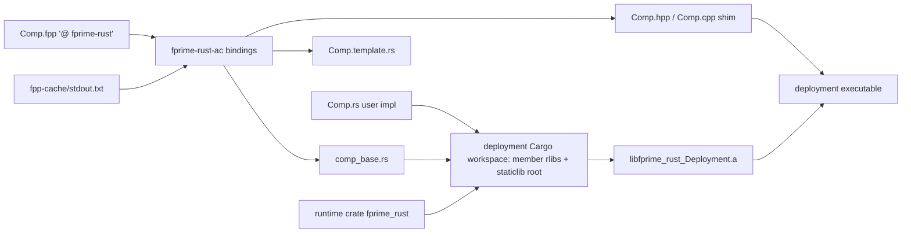
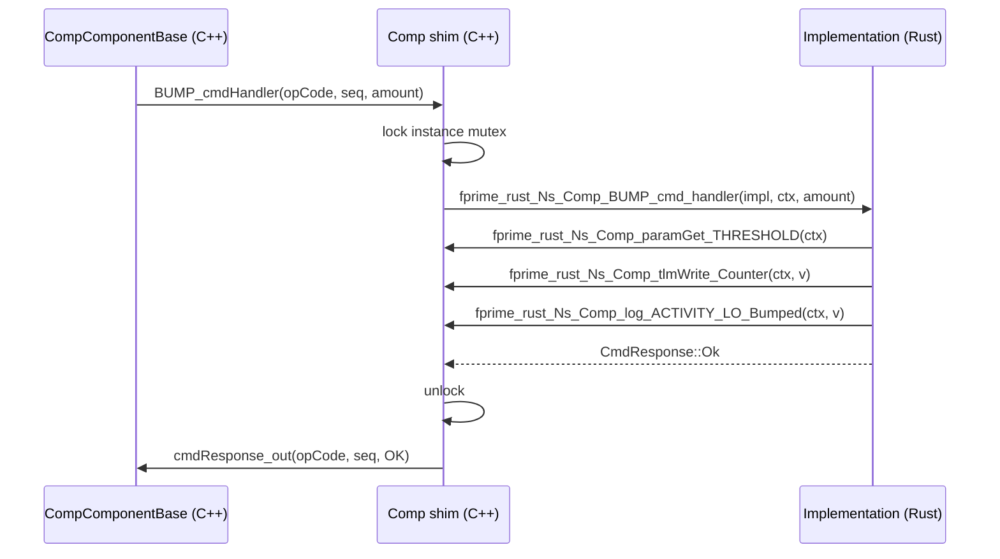

# fprime-rust — Software Design Description

## Introduction

`fprime-rust` lets an F Prime component be implemented in Rust. The component stays an FPP model; the
annotation `@ fprime-rust` marks it as Rust-implemented; the `fprime-rust-ac` autocoder emits the C++
shim that plugs into the standard autocoded component base, a generated Rust base module (the typed
handler trait and the `Context` helpers), and a user template. One deployment-level Cargo workspace
compiles every Rust component of a deployment and the runtime into one static archive linked once into
the executable. The user writes the `.fpp` and the `.rs`; no `.cpp`/`.hpp` is written by hand.

## Requirements

| ID | Requirement | Verification |
|---|---|---|
| REQ-FprimeRust-001 | The autocoder shall generate Rust and C++ sources for a component if and only if it carries `@ fprime-rust`. | Unit Test |
| REQ-FprimeRust-002 | The autocoder shall obtain the model by `fprime-fpp-python` analysis of the module's closure, with no JSON model. | Unit Test |
| REQ-FprimeRust-003 | The autocoder shall read the FPP closure from the module build cache `fpp-cache/stdout.txt`. | Unit Test |
| REQ-FprimeRust-004 | The autocoder shall fail with the FPP diagnostics when the model does not analyze cleanly. | Unit Test |
| REQ-FprimeRust-005 | The autocoder shall generate, per component, a C++ shim deriving from the autocoded component base. | Unit Test |
| REQ-FprimeRust-006 | The autocoder shall generate, per component, a Rust base module declaring the handler trait and `Context`. | Unit Test |
| REQ-FprimeRust-007 | The autocoder shall generate a user template `<Name>.template.rs` and seed `<Name>.rs` when absent. | Unit Test |
| REQ-FprimeRust-008 | A `@ fprime-rust` component of kind active, queued or passive shall dispatch its handlers to Rust. | Unit Test; Integration Test: L2-1, L2-4, L2-5 |
| REQ-FprimeRust-009 | Each typed input port (sync, guarded, async) shall dispatch to a Rust handler with its FPP arguments. | Unit Test; Integration Test: L2-3, L2-4 |
| REQ-FprimeRust-010 | A Rust handler shall be able to invoke each typed output port of its component with its FPP arguments. | Unit Test; Integration Test: L2-3, L7-1 |
| REQ-FprimeRust-011 | Ports between Rust and C++ components shall deliver their arguments unchanged in both directions. | Integration Test: L2-3, L2-4, L7-1 |
| REQ-FprimeRust-012 | Each command (async, sync, guarded) shall dispatch to a Rust handler whose return value is the command response. | Unit Test; Integration Test: L2-1, L2-5, L6-1 |
| REQ-FprimeRust-013 | Each event of the component shall be emittable from Rust with its FPP arguments at its declared severity. | Unit Test; Integration Test: L2-1, L2-5, L5-1, L6-1 |
| REQ-FprimeRust-014 | Each telemetry channel of the component shall be writable from Rust. | Unit Test; Integration Test: L2-1, L2-4, L4-1 |
| REQ-FprimeRust-015 | A Rust handler shall read each parameter of its component with its validity. | Unit Test; Integration Test: L2-2, L5-1 |
| REQ-FprimeRust-016 | FPP types shall map to Rust types per the type-mapping table. | Unit Test |
| REQ-FprimeRust-017 | An FPP element in the rejected-element table shall fail generation with a diagnostic naming the element. | Unit Test |
| REQ-FprimeRust-018 | A deployment executable shall contain exactly one copy of the Rust runtime. | Unit Test; Inspection |
| REQ-FprimeRust-020 | A deployment including `FprimeRust` between `FPrime.cmake` and `fprime_setup_included_code()` shall build its Rust components. | Unit Test |
| REQ-FprimeRust-021 | A Rust component shall build from a module registering only its `.fpp` and `.rs` sources. | Unit Test |
| REQ-FprimeRust-022 | The autocoder shall rerun when any translation unit or closure file changes. | Unit Test |
| REQ-FprimeRust-023 | Handlers of one component instance shall never run concurrently on its Rust state. | Unit Test |
| REQ-FprimeRust-024 | A Rust panic shall reach the F Prime assertion hook with its message and location, then abort. | Unit Test |
| REQ-FprimeRust-025 | The Rust implementation shall be constructed once at instantiation and dropped at destruction. | Unit Test |
| REQ-FprimeRust-026 | Generated C++ and Rust names shall match the generated-name table. | Unit Test |
| REQ-FprimeRust-027 | A cookiecutter shall create a Rust component with `.fpp`, `.rs`, CMakeLists and `docs/sdd.md`. | Unit Test |
| REQ-FprimeRust-028 | Two generations from an unchanged model shall produce byte-identical files. | Unit Test |
| REQ-FprimeRust-030 | A parameter update shall invoke the component's Rust parameter-updated handler with the parameter id. | Unit Test |
| REQ-FprimeRust-031 | Each internal port shall dispatch to a Rust handler and be invocable from Rust. | Unit Test |
| REQ-FprimeRust-032 | Each `hook` queue-full member shall dispatch its overflow hook to Rust. | Unit Test |
| REQ-FprimeRust-033 | A typed input port with a return type shall return the Rust handler's value to the caller. | Unit Test |
| REQ-FprimeRust-034 | A missing, empty or stale `fpp-cache/stdout.txt` shall fail generation naming the cache path. | Unit Test |
| REQ-FprimeRust-035 | The build shall fail at configure naming `FPRIME_RUST_CARGO` when cargo is not found. | Unit Test |
| REQ-FprimeRust-036 | A Rust compile error shall fail the deployment build with the cargo diagnostics. | Unit Test |
| REQ-FprimeRust-037 | A Rust string shall be stored truncated to its carrier capacity and at any interior NUL. | Unit Test |
| REQ-FprimeRust-038 | Incoming string bytes that are not valid UTF-8 shall be replaced by U+FFFD. | Unit Test |
| REQ-FprimeRust-039 | A deployment with no `@ fprime-rust` component shall build without invoking cargo. | Unit Test |
| REQ-FprimeRust-040 | The autocoder shall run on hosts with `fprime-fpp-python` wheels: linux-x86_64, macOS-arm64, win-x64. | Inspection |

Type-mapping table (REQ-FprimeRust-016):

| FPP | Rust |
|---|---|
| U8..U64, I8..I64 | u8..u64, i8..i64 |
| F32, F64 | f32, f64 |
| bool | bool |
| enum E | generated `#[repr(<FPP repr>)] enum E` |
| string (any size) | `&str` in; `&str` out (copied by the shim, REQ-037) |
| alias type `type T = U` | as its underlying type `U` |

Rejected-element table (REQ-FprimeRust-017; each fails generation naming the element):

| Element | Reason |
|---|---|
| serial port | handler takes a serialization buffer |
| state machine instance | actions and guards take a state-machine id and signal |
| data-product container or product port | handler takes `Fw::DpContainer` |
| struct, array or abstract type (e.g. `Fw.Buffer`, `Fw.ComBuffer`) argument or return type | not carried over the C ABI in this release |

Carrier capacity (REQ-FprimeRust-037): the declared `string size`, else the carrier's bound:
`FW_CMD_STRING_MAX_SIZE` (command arguments), `FW_PARAM_STRING_MAX_SIZE` (parameters),
`FW_LOG_STRING_MAX_SIZE` (events), `FW_TLM_STRING_MAX_SIZE` (telemetry),
`FW_INTERNAL_INTERFACE_STRING_MAX_SIZE` (internal ports), `FW_FIXED_LENGTH_STRING_SIZE` (typed-port
`Fw::String`).

## Design



Generated-name table (component `Ns.Comp`, element `X`; FFI symbols are `fprime_rust_Ns_Comp_<suffix>`):

| Element | C++ shim | FFI suffix | Rust |
|---|---|---|---|
| input port X (sync, guarded, async) | `X_handler(portNum, args)` | `X_handler` | `fn X_handler(&mut self, ctx: &mut Context<'_>, port_num, args) [-> R]` |
| output port X | `X_out(portNum, args)` | `X_out` | `ctx.X_out(port_num, args) [-> R]` |
| internal port X | `X_internalInterfaceHandler(args)` / `X_internalInterfaceInvoke(args)` | `X_internal_handler` / `X_internal_invoke` | `fn X_internal_handler(&mut self, ctx, args)` / `ctx.X_internal_invoke(args)` |
| `hook` member X | `X_overflowHook(portNum, args)` / `X_cmdOverflowHook(opCode, cmdSeq)` | `X_overflow_hook` | `fn X_overflow_hook(&mut self, ctx, …)` (template stub; command stub responds `BUSY`) |
| command X (async, sync, guarded) | `X_cmdHandler(opCode, cmdSeq, args)` | `X_cmd_handler` | `fn X_cmd_handler(&mut self, ctx, args) -> CmdResponse` |
| event X severity S | `log_S_X(args)` | `log_S_X` | `ctx.log_S_X(args)` |
| telemetry X | `tlmWrite_X(v)` | `tlmWrite_X` | `ctx.tlmWrite_X(v)` |
| parameter X | `paramGet_X(valid)` | `paramGet_X` | `ctx.paramGet_X() -> (T, ParamValid)` |
| parameterUpdated | `parameterUpdated(id)` | `parameter_updated` | `fn parameter_updated(&mut self, ctx, id: FwPrmIdType)` (default no-op) |
| queued dispatch (queued components only) | `this->dispatchAvailableMessages()` in every generated sync/guarded entry, before the FFI call | — | none: the queue is drained by the shim before `&mut Implementation` exists; `ctx.last_dispatch() -> MsgDispatchStatus` reports the base status (stops on the first non-OK; at most the messages present at entry) |
| lifecycle | ctor / `init` / dtor | `new`, `init`, `drop` | `Implementation::new()`, `fn init(&mut self, ctx: &InitContext)`, `Drop` |

FFI carriers: integers and floats at their width; `bool` as `u8` (shim writes 0/1, Rust reads `!= 0`); enums as
their repr integer; strings as `(*const u8, len)` borrowed for the call (in: `from_utf8_lossy`, REQ-038; out:
copied into the C++ `Fw::StringBase` carrier within the call, truncated to capacity, REQ-037); port return
values through an out-pointer. `MsgDispatchStatus` mirrors `Fw::QueuedComponentBase::MsgDispatchStatus`.

Artifacts per component: `Comp.hpp`, `Comp.cpp` (shim, `final`, derives `CompComponentBase`), `comp_base.rs`
(trait `Component`, `Context<'call>`, `InitContext`, `#[no_mangle] extern "C"` entry points boxing
`Implementation`), `Comp.template.rs`. Per executable: `fprime_rust/Cargo.toml` (workspace),
`fprime_rust/<ns>_<comp>/` (rlib: `comp_base.rs` + `#[path]` include of the user's `Comp.rs`),
`fprime_rust/fprime_rust_<Target>/` (staticlib; `lib.rs` is `pub use` of every member and of the runtime),
`libfprime_rust_<Target>.a`.

Linkage (one runtime per executable): `autocoder/fprime_rust.cmake` runs per module, returns `Comp.cpp` as
build sources and `Comp.hpp`/`*.rs` as other outputs, removes `.rs` files from the compiled source list, and
records the component and its `.rs` on the module target (`FPRIME_RUST_COMPONENTS`, `FPRIME_RUST_SOURCES`).
`target/fprime_rust.cmake` runs per deployment and per unit-test executable: it walks the executable's full
dependency list, collects every recorded component, runs `fprime-rust-ac crate` once to emit the workspace,
builds it with `cargo build --profile <FPRIME_RUST_PROFILE> --target <FPRIME_RUST_TARGET> --target-dir
<bin>/fprime_rust/target` (every profile: `panic = "abort"`, `lto = true`, `overflow-checks = false`; lints
`unsafe_op_in_unsafe_fn`, `clippy::unwrap_used`, `clippy::expect_used`, `clippy::indexing_slicing`,
`clippy::arithmetic_side_effects` = deny), and links the single archive plus the `native-static-libs` cargo
reports `PRIVATE` into the executable. The shim's `extern "C"` references resolve at that final link, so
Rust std and the runtime exist once per executable; a component unit-test executable gets its own
`libfprime_rust_<Comp>_ut.a` the same way (`FprimeRust.cmake` registers `target/fprime_rust` with both
`register_fprime_target` and `register_fprime_ut_target`, so `register_fprime_ut` executables receive their own archive). There is no topology annotation (fprime-python marks the
deployment topology): the executable is the deployment, and an executable with no recorded component invokes
no cargo and links no archive (REQ-039). Rejected: one staticlib per component (the MVP: every archive
carries its own std, giving duplicate symbols and N-fold footprint); a shared dynamic library or
`-C prefer-dynamic` (loader at run time, not flight-like, platform-specific); linking rlibs from C++ (an
rlib is not a C-ABI artifact); merging per-component archives with `ar`/`objcopy --localize`
(toolchain-specific and fragile).

Model loading: `fprime-rust-ac bindings <bindir> [--dry-run] --output-directory <bindir> --prefixes
<FPRIME_BUILD_LOCATIONS> --translation-units <fpp...>` reads `<bindir>/fpp-cache/stdout.txt` (one closure
path per line, written by F Prime's `fpp_depend` sub-build; missing, empty or unreadable entries fail naming
the path, REQ-034), deduplicates sources against imports, and calls `fpp.analyze(sources, imports=...)` from
`fprime-fpp-python==4.0.1`; diagnostics fail generation. Types and names come from
`fprime-cpp-codegen==0.2.0`. No JSON model is generated or read; `FPRIME_ENABLE_JSON_MODEL_GENERATION` must
not be set. Platform constraint: `fprime-fpp-python` wheels exist only for linux-x86_64 (cp310-abi3
manylinux2014), macOS-arm64 and win-x64 (REQ-040); the Rust archive is built for `FPRIME_RUST_TARGET`
(default: host triple) and only the host triple is exercised by this campaign. Allocation profile: generated
code allocates once per instance at construction (`Box<Implementation>`) and, after initialization, only when
an incoming string is not valid UTF-8 (`from_utf8_lossy`); all other generated paths are allocation-free; Rust
std is linked, so an allocation-free deployment must audit the user `.rs` files. Deliberate deviation from
fprime-python: struct, array and abstract types are rejected in this release (follow-on: serializers from
`fprime-cpp-codegen`).

### Configure

```cmake
# deployment CMakeLists.txt — no FPRIME_ENABLE_JSON_MODEL_GENERATION: the model is read in-process
include("${CMAKE_CURRENT_LIST_DIR}/lib/fprime/cmake/FPrime.cmake")
include(FprimeRust)                 # register_fprime_target + register_fprime_ut_target(target/fprime_rust)
fprime_setup_included_code()
```
```ini
[fprime]
library_locations: ./lib/fprime-rust
```
```cmake
# Rust component CMakeLists.txt
register_fprime_module(AUTOCODER_INPUTS "${CMAKE_CURRENT_LIST_DIR}/Comp.fpp"
                       SOURCES "${CMAKE_CURRENT_LIST_DIR}/Comp.rs")
```
Constants: `FPRIME_RUST_CARGO` (cargo path, default from PATH; configure fails naming it when absent,
REQ-035), `FPRIME_RUST_PROFILE` (default `release`), `FPRIME_RUST_TARGET` (default host triple). Python
package `fprime-rust`: dependencies `fprime-fpp-python==4.0.1`, `fprime-cpp-codegen==0.2.0`; script
`fprime-rust-ac`; `cookiecutters/component` (`component_name`, `component_namespace`, `component_kind`).

### Behavior

The shim is the F Prime component: the autocoded base owns the queue, thread, mutexes and dispatch, so the
component kind is honored unchanged. Each handler the base calls is forwarded over the FFI with the opaque
`Implementation` pointer and a `Context<'call>` that borrows the shim's stack frame (neither `Send` nor
`Sync`; storing it in `Implementation` is a compile-time error). Memory crosses the FFI only as borrowed
pointers valid for the call; no allocation changes owner. Instance mutex rule, every component kind: the
shim takes the instance's non-recursive `Os::Mutex` in every FFI entry that receives `&mut Implementation`
— port handlers of all kinds, internal-port and command handlers, overflow hooks, `parameter_updated`,
`init` — with one exception generated per kind: on a `queued` component the async port, async command and
internal-port entries take no lock, because they are reachable only through the drain below. Queued dispatch
(no Rust-visible primitive): every generated sync/guarded entry of a queued component takes the lock once,
calls `this->dispatchAvailableMessages()` (base semantics: at most the messages present at entry, stops on
the first non-OK status), and only then constructs `&mut Implementation` for the user handler, so the
dispatched async handlers and the sync handler never hold two live `&mut Implementation`; the base status is
readable as `ctx.last_dispatch()`. A synchronous call path that re-enters the same instance, or forms a cycle
of synchronous ports through several Rust instances, is a design error documented in the template:
Rust-to-Rust synchronous edges are lock edges and must form a DAG (break cycles with an `async` port, as the
reference does with `relay.countOut -> rustMonitor.countIn`). On a Rust component `sync` and `guarded` inputs
are therefore equivalent and a Rust component is not suitable for lock-free cyclic work shared by several
callers. Overflow hooks run on the caller's thread under the same mutex; on an active component a hook
therefore blocks the caller until the running handler returns — use `drop` (or `assert`) on inputs driven by
rate groups or drivers, and `hook` only where the caller can afford to wait.
`init` receives an `InitContext` with no port, event, telemetry or parameter access; parameters are
available from the first handler call (after `loadParameters`). Command handlers return `CmdResponse`,
which the shim forwards to `cmdResponse_out`. The runtime installs a panic hook once per process that
forwards message and location to the F Prime assertion hook before `abort` (REQ-024); the alloc-error
handler aborts the same way. The Rust implementation is constructed by the shim constructor and dropped by
its destructor.



## Tests

<!-- fth:tests:begin -->
_Generated by `fth render-sdd-tests` from the plan — do not edit by hand; the package renderer fails when this table and the plan disagree._

| Test | Purpose | Requirements |
|---|---|---|
| L0-1 | Confirms the running executable reports non-empty project, framework and library version strings for the delivery manifest check. | — |
| L0-2 | Proves the marker command round-trips through the command path so every later window can be bracketed. | — |
| L2-1 | Resets and bumps the Rust active component to prove async commands dispatch into Rust and events and telemetry come back out. | REQ-FprimeRust-008, REQ-FprimeRust-012, REQ-FprimeRust-013, REQ-FprimeRust-014, REQ-RustCounter-001, REQ-RustCounter-002, REQ-RustCounter-004 |
| L2-2 | Sets THRESHOLD to 5 and bumps past it to prove the Rust handler reads the parameter and saturates on it. | REQ-FprimeRust-015, REQ-RustCounter-003, REQ-RustCounter-006 |
| L2-3 | Bumps the Rust counter and follows the count through the C++ relay into the Rust monitor to prove typed ports in both directions. | REQ-FprimeRust-009, REQ-FprimeRust-010, REQ-FprimeRust-011, REQ-RustCounter-002, REQ-RustCounter-004, REQ-RustMonitor-003, REQ-Relay-001, REQ-Relay-002 |
| L2-4 | Lets the 1 Hz rate group tick the active Rust component and run the queued Rust component to prove C++ scheduler ports into Rust handlers. | REQ-FprimeRust-008, REQ-FprimeRust-009, REQ-FprimeRust-011, REQ-FprimeRust-014, REQ-RustCounter-005, REQ-RustMonitor-005 |
| L2-5 | Sets the monitor limit then bumps past it to prove a queued Rust component handles commands and raises a warning event from a relayed count. | REQ-FprimeRust-008, REQ-FprimeRust-012, REQ-FprimeRust-013, REQ-RustMonitor-001, REQ-RustMonitor-004, REQ-RustMonitor-006, REQ-RustMonitor-003 |
| L4-1 | Runs the deployment for 60 s to prove the Rust components keep servicing rate-group ports with no command errors or counter drift. | REQ-FprimeRust-014, REQ-RustCounter-005, REQ-RustMonitor-005 |
| L5-1 | Drives the counter into THRESHOLD saturation to prove the Rust warning event and the clamp. | REQ-FprimeRust-013, REQ-FprimeRust-015, REQ-RustCounter-003, REQ-RustCounter-006 |
| L6-1 | Sends an invalid limit to prove the Rust handler rejects it with a validation error and changes nothing else. | REQ-FprimeRust-012, REQ-FprimeRust-013, REQ-RustMonitor-002, REQ-RustMonitor-006 |
| L7-1 | Saves THRESHOLD 42 into the parameter file, downlinks the file into the record and resets the counter to leave the deployment in an independently verifiable state. | REQ-FprimeRust-010, REQ-FprimeRust-011, REQ-RustCounter-001, REQ-RustCounter-004, REQ-Relay-001, REQ-Relay-002, REQ-RustMonitor-003 |
<!-- fth:tests:end -->

## Unit-test list

| Test | Description | Requirements |
|---|---|---|
| UT-AC-1 | `bindings` on an annotated component emits `Comp.hpp`, `Comp.cpp`, `comp_base.rs`, `Comp.template.rs`; an unannotated component and an annotated port/module emit nothing | REQ-FprimeRust-001, REQ-FprimeRust-005, REQ-FprimeRust-006, REQ-FprimeRust-007 |
| UT-AC-2 | model loads from a fixture `fpp-cache/stdout.txt` with no JSON file read or written; missing file, empty file and unreadable entry each raise `ModelError` naming the path | REQ-FprimeRust-002, REQ-FprimeRust-003, REQ-FprimeRust-034 |
| UT-AC-3 | model with an undefined symbol fails with the `fpp` diagnostic text (`symbol X is not defined`) | REQ-FprimeRust-004 |
| UT-AC-4 | generated names for every row of the name table equal the table (fixture component with each element kind) | REQ-FprimeRust-026 |
| UT-AC-5 | each type-table row maps as stated, including an alias `type Count = U32` mapping to `u32`; serial port, state machine, data-product container, struct argument, array return, `Fw.Buffer` argument and `Fw.ComBuffer` argument each fail with `unsupported element <qualified name>` | REQ-FprimeRust-016, REQ-FprimeRust-017 |
| UT-AC-6 | `crate` emits one workspace with one rlib member per component and one staticlib root whose `lib.rs` re-exports every member | REQ-FprimeRust-018 |
| UT-AC-7 | two runs on an unchanged model produce byte-identical output (sha256 equal) | REQ-FprimeRust-028 |
| UT-AC-8 | `--dry-run` lists exactly the files later written, and the custom command's DEPENDS equals the closure list | REQ-FprimeRust-022 |
| UT-AC-9 | cookiecutter renders `.fpp`, `.rs`, `CMakeLists.txt`, `docs/sdd.md` for each `component_kind` | REQ-FprimeRust-027 |
| UT-RT-1 | `CmdResponse`/`ParamValid`/`MsgDispatchStatus` round-trip their F Prime integer codes | REQ-FprimeRust-012, REQ-FprimeRust-015 |
| UT-RT-2 | `Context` is neither `Send` nor `Sync` (`static_assertions::assert_not_impl_any!`) | REQ-FprimeRust-023 |
| UT-RT-3 | a panic in a handler reaches the registered F Prime assert hook with the Rust `file:line`, then the process aborts (death test) | REQ-FprimeRust-024 |
| UT-RT-4 | `cargo miri test` over the queued fixture of UT-SHIM-6 (shim entries replayed from Rust): no Stacked Borrows violation reported | REQ-FprimeRust-023 |
| UT-SHIM-1 | GTest tester base over the shim: one async, one sync and one guarded command each reach Rust and return `OK`/`VALIDATION_ERROR` as the fixture dictates | REQ-FprimeRust-012 |
| UT-SHIM-2 | one sync, one guarded and one async typed input port reach Rust with arguments; a port with a return type returns the Rust value; a Rust output-port call invokes the C++ port with the same arguments | REQ-FprimeRust-009, REQ-FprimeRust-010, REQ-FprimeRust-033 |
| UT-SHIM-3 | active fixture: a guarded port called from a second thread while an async handler sleeps is serialized (observed order, no overlap); passive fixture: two sync callers serialized | REQ-FprimeRust-023 |
| UT-SHIM-4 | constructor calls `new` once; `init` once with no port access; destructor drops once; `parameterUpdated(id)` reaches Rust once per `PRM_SET` | REQ-FprimeRust-025, REQ-FprimeRust-030 |
| UT-SHIM-5 | one fixture per kind (active, queued, passive) dispatches a port and a command to Rust | REQ-FprimeRust-008 |
| UT-SHIM-6 | queued fixture: two messages queued before `run`; the generated `run` entry drains both handlers exactly once on the caller's thread before `run_handler` is entered, `ctx.last_dispatch()` is `Empty`, no lock is re-taken (a non-recursive mutex would deadlock) | REQ-FprimeRust-008, REQ-FprimeRust-023 |
| UT-SHIM-7 | one event per severity (ACTIVITY_LO/HI, WARNING_LO/HI, COMMAND, DIAGNOSTIC) is logged with arguments; FATAL under the death-test fixture | REQ-FprimeRust-013 |
| UT-SHIM-8 | telemetry of each type-table row is written with the value; `paramGet` returns `(value, VALID)`, `(default, DEFAULT)` and `(value, INVALID)` per fixture | REQ-FprimeRust-014, REQ-FprimeRust-015 |
| UT-SHIM-9 | internal port invoked from Rust reaches the Rust internal handler through the queue; an async port and an async command with `hook` call the Rust overflow hook when the queue is full (command hook responds `BUSY`) | REQ-FprimeRust-031, REQ-FprimeRust-032 |
| UT-SHIM-10 | a 48-byte Rust string into an unsized command-string argument is stored as its first `FW_CMD_STRING_MAX_SIZE` (40) bytes and into a `string size 40` event as its first 40 bytes; `"ab\0cd"` is stored as `"ab"`; incoming bytes `0xFF 0x41` arrive as `"\u{FFFD}A"` | REQ-FprimeRust-037, REQ-FprimeRust-038 |
| UT-BUILD-1 | CMake build of a two-component fixture deployment registered per §Configure: exactly one `libfprime_rust_<Deployment>.a` on the link line; `nm` shows exactly one `T` definition of the exported runtime marker `fprime_rust_runtime_marker`; no duplicate-symbol diagnostics | REQ-FprimeRust-018, REQ-FprimeRust-020, REQ-FprimeRust-021 |
| UT-BUILD-2 | fixture deployment with no annotated component builds; cargo is not invoked (no `fprime_rust/` directory); with `FPRIME_RUST_CARGO` pointing at a missing file configure fails naming it; a user `.rs` with a type error fails the build with the rustc diagnostic | REQ-FprimeRust-039, REQ-FprimeRust-035, REQ-FprimeRust-036 |
| UT-INSP-1 | inspection: `pip download fprime-fpp-python==4.0.1 --only-binary :all:` succeeds for the three stated platform tags and no other | REQ-FprimeRust-040 |
